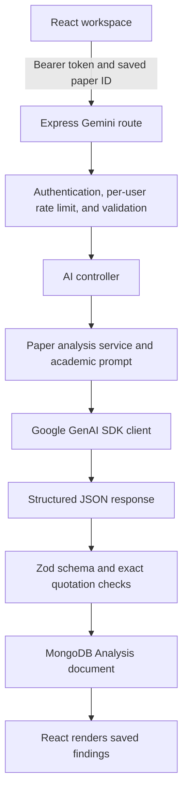

# ResearchLens architecture

ResearchLens is a TypeScript application with a React/Vite client and an Express/Mongoose API. The browser client is served by Vite during development; requests under `/api` are handled by the API server.

## Client

- `client/src/main.tsx` mounts the React application.
- `client/src/App.tsx` contains the current workspace interface and page state.
- `client/src/components/` contains reusable controls, layout pieces, and research visualizations.
- `client/src/features/` groups feature-level APIs, types, and hooks.
- `client/src/services/api.ts` centralizes JSON requests and bearer-token handling.
- `client/src/services/storage.ts` stores the local session and appearance preference.

The interface includes clearly labeled illustrative records. Saved account data requires a configured API and MongoDB connection.

## Server

- `server/src/server.ts` starts the HTTP listener.
- `server/src/app.ts` configures security headers, CORS, request parsing, rate limiting, health checks, and API routes.
- `server/src/Config/` loads environment settings and connects to MongoDB.
- `server/src/routes/index.ts` currently contains the active API route handlers. The feature-specific controllers and route modules provide the modular structure for separating those handlers.
- `server/src/model/index.ts` defines the models currently used by the active API. `server/src/Models/` exposes feature model modules.

PDF uploads are parsed in memory, with a 25 MB upload limit. The database stores extracted text for authenticated papers. Gemini paper analysis follows this request lifecycle:

The server only analyzes papers owned by the requesting user. Extracted text takes precedence over the abstract and is capped at 80,000 characters before it is sent to Gemini. Candidate gaps are not novelty claims; quotations are retained only when they exactly match the submitted text.

## Local development

1. Install root dependencies with `npm install`.
2. Copy `server/.env.example` to `server/.env` and set `MONGODB_URI`, a random `JWT_SECRET` of at least 32 characters, and a newly created `GEMINI_API_KEY`.
3. Run `npm run dev` from the repository root.

The client runs on Vite's default development port and the API listens on port 3001 by default. Set `CORS_ORIGIN` to a comma-separated allowlist when configuring explicit browser origins.
